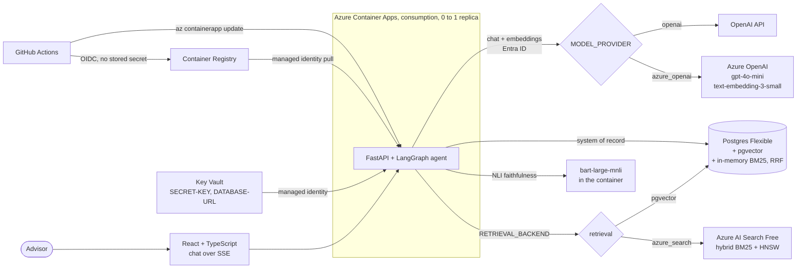

# AI Financial Advisor

A RAG app for financial advisors. Upload client documents, ask questions over them in a streaming chat, and generate reports grounded in those documents. FastAPI and LangGraph on the backend, React and TypeScript on the frontend, Server-Sent Events for streaming.

The same code runs two ways, switched only by environment variables:

| | Local (default) | Azure |
|---|---|---|
| Models | OpenAI (`gpt-4o`, `text-embedding-3-small`) | Azure OpenAI (`gpt-4o-mini`, `text-embedding-3-small`), Entra ID auth, keys disabled |
| Retrieval | pgvector dense + BM25, fused with RRF | Azure AI Search hybrid query (BM25 + vector, RRF on the service) or the same pgvector path |
| Secrets | `.env` | Key Vault, read by a managed identity |
| Hosting | Docker Compose | Azure Container Apps, consumption plan, scales to zero |

## What it does

- **Streaming Q&A.** Questions go through a LangGraph agent (classify, retrieve, rerank, compress, market data, generate, score) and stream back over SSE with source chunk ids.
- **Document ingestion.** PDF, CSV, Excel and images are parsed, PII-redacted with Presidio, chunked, embedded and indexed.
- **Hybrid retrieval.** pgvector (HNSW) plus BM25 fused with Reciprocal Rank Fusion, optional HyDE query expansion. Or Azure AI Search with `RETRIEVAL_BACKEND=azure_search`.
- **Faithfulness score.** Each answer sentence is checked against the retrieved context with an NLI model (`facebook/bart-large-mnli`); low scores trigger up to two retrieval retries.
- **Reports, market data, multi-tenancy.** Report generation that refuses to run without indexed documents, Alpha Vantage quotes, JWT auth with advisor-client ownership checks, append-only audit log.

## Architecture



Postgres stays the system of record in both modes. With `azure_search`, ingestion also upserts each chunk (text + vector) into one search index, and document deletes remove them.

## Run it locally

Needs Docker and an OpenAI API key.

```bash
git clone https://github.com/hariharan-brucewayne220/ai-financial-advisor.git
cd ai-financial-advisor
cp .env.example .env        # set OPENAI_API_KEY and SECRET_KEY
docker compose up --build
```

| Service | URL |
|---|---|
| Frontend | http://localhost |
| API docs (Swagger) | http://localhost/api/docs |
| Backend direct | http://localhost:8000 |

On startup the API creates the `vector` extension and any missing tables. Docker Compose also runs `scripts/init_db.sql`.

### Switching provider and retrieval backend

```bash
# Azure OpenAI with your az login (no key needed)
MODEL_PROVIDER=azure_openai
AZURE_OPENAI_ENDPOINT=https://<resource>.openai.azure.com
AZURE_OPENAI_CHAT_DEPLOYMENT=gpt-4o-mini
AZURE_OPENAI_EMBEDDING_DEPLOYMENT=text-embedding-3-small

# Azure AI Search instead of pgvector + BM25
RETRIEVAL_BACKEND=azure_search
AZURE_SEARCH_ENDPOINT=https://<service>.search.windows.net
```

`AZURE_OPENAI_API_KEY` and `AZURE_SEARCH_API_KEY` exist for local experiments but are optional. Without them the app uses `DefaultAzureCredential`, which is the managed identity in Azure and `az login` on a laptop. The Bicep template disables key auth on both services.

### Tests

```bash
cd backend
python -m venv .venv && source .venv/bin/activate
pip install -r requirements-core.txt -r requirements-test.txt
python -m pytest
```

`requirements-core.txt` skips the multi-GB ML packages, so the NLI test that needs the real model is skipped unless `transformers` is installed. The schema test runs when `TEST_DATABASE_URL` points at a throwaway pgvector database. GitHub Actions runs all of it on every push, with a pgvector service container, and also compiles the Bicep, shellchecks the scripts and builds the Docker image when its inputs change.

The Azure paths are tested against in-process mock endpoints: the tests check the exact URL, auth header, request body and model or deployment name sent to Azure OpenAI and Azure AI Search.

## Eval

42 questions over IRS Publication 590-A and 590-B (2025), public domain, in `backend/eval/`. Each question carries an evidence span copied from the parsed text; a chunk counts as relevant if it contains the span. Corpus: 2 PDFs, 133 pages, 3.9 MB, which the app's own chunker turns into 244 chunks and 200,227 tokens. Well inside the Search Free tier's 50 MB.

```bash
cd backend
python -m eval.run_eval ingest [--azure-search]        # parse, chunk, embed, store
python -m eval.run_eval run --backends bm25,pgvector,hybrid,azure_search --answer
```

Every number below comes from a real run. Commands, environment and raw output for each are in [docs/results.md](docs/results.md), and the per-question rows are in `backend/eval/out/`.

| Backend | recall@5 | hit@5 | MRR@5 | Faithfulness (NLI) | p50 / p95 latency | Cost per 100 questions |
|---|---|---|---|---|---|---|
| BM25 only (baseline) | 0.714 | 0.738 | 0.565 | n/a | 50 / 69 ms (retrieval) | $0 |
| pgvector (dense) | not run yet | | | | | |
| Hybrid (pgvector + BM25, RRF) | not run yet | | | | | |
| Azure AI Search (hybrid) | not run yet | | | | | |

The pgvector, hybrid and Azure AI Search rows need an embeddings API, which costs money, so they wait for an OpenAI key or the Azure resources. Definitions: recall@5 is the share of a question's relevant chunks in the top 5, hit@5 the share of questions with any relevant chunk in the top 5, and cost uses API-reported token counts times the prices in `backend/eval/prices.json`.

## Deploy to Azure

Infra lives in `infra/main.bicep`. The app runs as a user-assigned managed identity that pulls from ACR, reads `SECRET-KEY` and `DATABASE-URL` from Key Vault, and calls Azure OpenAI and AI Search with Entra ID. GitHub Actions logs in through an OIDC federated credential on a second identity that can only push images and update the container app. No keys or client secrets are stored in code, env files or GitHub.

```bash
az login
RG=finadv-rg LOCATION=eastus2 ./scripts/deploy_infra.sh   # creates billable resources
# set the GitHub variables it prints, then merge to main: .github/workflows/deploy.yml deploys
RG=finadv-rg ./scripts/teardown.sh                        # deletes everything and purges soft-deleted vault + OpenAI account
```

The first infra deploy runs a placeholder image; the first push to `main` builds the real image, pushes it to ACR, points the app at it and smoke-tests `/health`.

## Cost notes

Prices checked on Azure's and OpenAI's pricing pages on 2026-10-27. Re-check before relying on them.

| Resource | Tier | Price | Notes |
|---|---|---|---|
| Container Apps | Consumption, 2 vCPU / 4 GiB, min 0 replicas | $0.000024 per vCPU-s and $0.000003 per GiB-s active; first 180,000 vCPU-s, 360,000 GiB-s and 2M requests per month free | Idle cost is zero when scaled to zero |
| Postgres Flexible Server | Burstable B1ms, 32 GiB | $12.41 per month plus $0.115 per GiB-month storage | The main fixed cost, about $0.53 a day all in |
| Container Registry | Basic | $0.167 per day | |
| Azure AI Search | Free | $0 | 50 MB, 3 indexes, one per subscription; may be deleted after long inactivity |
| Azure OpenAI | gpt-4o-mini Global | $0.15 in / $0.60 out per 1M tokens | Pay per token |
| Azure OpenAI | text-embedding-3-small | $0.022 per 1M tokens | Embedding this whole corpus is about 200K tokens |
| Key Vault | Standard | per-operation pricing | Negligible at this volume |
| Log Analytics | not deployed | | Use `az containerapp logs show --follow` |

Keep a $10 budget alert on the subscription and run `scripts/teardown.sh` when you are done.

## Project structure

```
backend/
  app/
    llm.py                 OpenAI vs Azure OpenAI client (MODEL_PROVIDER)
    services/azure_search.py   Azure AI Search REST client (RETRIEVAL_BACKEND=azure_search)
    services/retriever.py  pgvector + BM25 + RRF, or Azure AI Search
    services/faithfulness_scorer.py   NLI faithfulness
    agents/                LangGraph QA and report agents
  eval/                    corpus, questions, harness, prices, run outputs
  tests/
infra/main.bicep           Azure resources
scripts/deploy_infra.sh    create or update the Azure resources
scripts/teardown.sh        delete them
.github/workflows/         tests, image build, deploy
docs/results.md            every measured number, with commands
frontend/                  React + Vite chat UI
```

## Known limitations

- **Rerank and compress are pass-throughs.** `_rerank_documents` sorts by the existing score and `_compress_context` returns the context unchanged. The cross-encoder and LLMLingua settings in `config.py` are not used.
- **Some flags are not wired in.** `ENABLE_PII_DETECTION`, `ENABLE_FAITHFULNESS_SCORING`, `PRESIDIO_ENTITIES_TO_SCAN` and `presidio_score_threshold` are defined but never read.
- **`bm25_tokens` is never populated,** so BM25 tokenizes chunk text on every query, and each request builds a fresh in-memory BM25 index because the agent is created per request.
- **Dense search orders by L2 distance** while the HNSW index is built with cosine ops, so Postgres does not use the index for it. Rankings are the same for OpenAI's unit-length embeddings, but it is a sequential scan.
- **The ARQ worker is not used.** Ingestion runs as a FastAPI background task.
- **The Azure image is large.** It carries CPU torch, the spaCy model and the NLI weights, so the first request after scale-to-zero waits for the image pull and model load.

## Next steps

- Run the eval rows above with real embeddings, on OpenAI and on Azure, and fill in the table.
- Use a real cross-encoder for the rerank node and measure it with the same harness.
- Move the NLI model to a separate service, or a smaller model, to shrink the API image and cold start.
- Deploy the frontend to Azure Static Web Apps and restrict CORS to it.
- Add a GitHub environment with required reviewers in front of the deploy job.

## License

MIT
